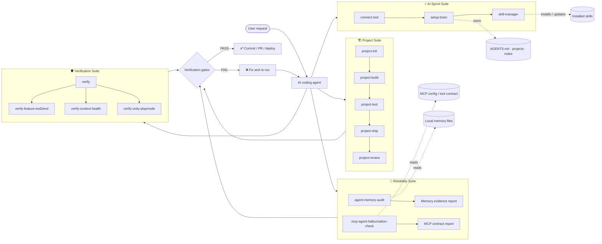
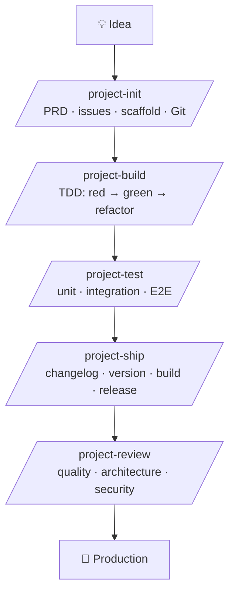
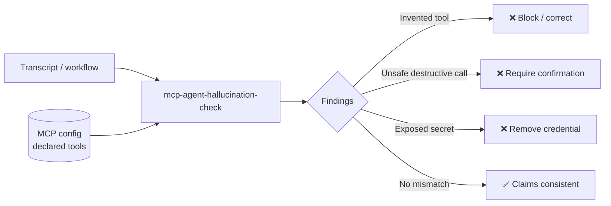
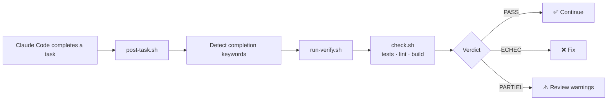

<!-- Banners -->
<p align="center">
  
</p>

<h1 align="center">skill-verify</h1>

<p align="center">
  <strong>The complete skill suite for AI coding agents that prove they work, not just say they do.</strong>
</p>

<p align="center">
  <a href="https://github.com/agtktID/skill-verify/blob/main/LICENSE">
    
  </a>
  <a href="https://github.com/agtktID/skill-verify/stargazers">
    
  </a>
  <a href="https://github.com/agtktID/skill-verify/network/members">
    
  </a>
  <a href="https://github.com/agtktID/skill-verify/releases">
    
  </a>
  
  
  
</p>

<p align="center">
  <a href="#-quick-start">Quick Start</a> ·
  <a href="#-install-via-claude-code">Claude Code Marketplace</a> ·
  <a href="#-architecture">Architecture</a> ·
  <a href="#-project-suite-5-skills">Project Suite</a> ·
  <a href="#-verification-suite">Verification Suite</a> ·
  <a href="#-reliability-suite">Reliability Suite</a> ·
  <a href="#-ai-sprint-suite-3-skills">AI Sprint Suite</a> ·
  <a href="#-auto-trigger-hook">Auto-Trigger</a> ·
  <a href="#-full-skill-catalogue">All Skills</a> ·
  <a href="./CONTRIBUTING.md">Contribute</a>
</p>

---

## 🎯 What is skill-verify?

**skill-verify** is an open-source collection of **18 Claude Code skills** designed to make AI agents
**prove their work** instead of hallucinating results.

It combines project delivery, execution-based verification, agent-memory auditing, MCP hallucination detection and reusable workspace tooling.

| Suite | Skills | Purpose |
|-------|--------|---------|
| 🏗️ **Project Suite** | `project-init` `project-build` `project-test` `project-ship` `project-review` | Build a complete project from idea to production |
| 🛡️ **Verification Suite** | `verify` `verify-feature-end2end` `verify-context-health` `verify-unity-playmode` | Prove it works with real execution |
| 🧠 **Reliability Suite** | `agent-memory-audit` `mcp-agent-hallucination-check` | Audit agent memory and validate claimed MCP tool usage |
| ⚡ **AI Sprint Suite** | `connect-tool` `setup-brain` `skill-manager` | Connect tools, organize an agent brain, and manage reusable skills |
| ⚙️ **Auto-Trigger Hook** | `post-task.sh` + `hooks.json` | Automatically verify after every completed task |

**Core principles:**

- 🚫 **Anti-hallucination** — No step is PASS without real Bash execution + exit code.
- 🧠 **Evidence over claims** — Memory and MCP tool claims must be checked against local evidence.
- 📦 **Progressive disclosure** — `SKILL.md` stays concise; heavy scripts live in `scripts/`.
- 🔁 **TDD-first** — Write the test before the code.
- 🔒 **Git guardrails** — Never force-push, never deploy without a PASS verdict.
- 📋 **Structured reports** — Every session produces `.verify/<timestamp>/report.md`.

---

## 🧭 Architecture



### Responsibility boundaries

| Skill | Owns | Delegates |
|---|---|---|
| `setup-brain` | Brain initialization, `AGENTS.md`, project hubs, notes, Git conventions | Skill installation, updates, removal and audits to `skill-manager` |
| `skill-manager` | Skill lifecycle: install, list, update, remove, create, improve, audit | Brain/workspace initialization and documentation changes to `setup-brain` |
| `agent-memory-audit` | Evidence-based audit of local memory claims | Execution and deployment to the verification suite |
| `mcp-agent-hallucination-check` | Static validation of claimed MCP tool calls against a declared contract | Actual MCP tool execution — it never calls tools |

---

## ⚡ Quick Start

### Install with 1 command

```bash
# Install all skills in your project
npx skills@latest add agtktID/skill-verify

# Or clone and copy manually
git clone https://github.com/agtktID/skill-verify.git
mkdir -p .claude/skills
cp -r skill-verify/skills/* .claude/skills/
```

### Install specific skills

```bash
# Just the verification suite
cp -r skill-verify/skills/verify .claude/skills/
cp -r skill-verify/skills/verify-feature-end2end .claude/skills/

# Just the project suite
cp -r skill-verify/skills/project-init .claude/skills/
cp -r skill-verify/skills/project-build .claude/skills/
cp -r skill-verify/skills/project-test .claude/skills/
cp -r skill-verify/skills/project-ship .claude/skills/
cp -r skill-verify/skills/project-review .claude/skills/

# Reliability suite
cp -r skill-verify/skills/agent-memory-audit .agents/skills/
cp -r skill-verify/skills/mcp-agent-hallucination-check .agents/skills/

# AI Sprint suite
cp -r skill-verify/skills/connect-tool .agents/skills/
cp -r skill-verify/skills/setup-brain .agents/skills/
cp -r skill-verify/skills/skill-manager .agents/skills/
```

### Install the auto-trigger hook

```bash
mkdir -p .claude/hooks
cp skill-verify/skills/verify/hooks/post-task.sh .claude/hooks/
cp skill-verify/skills/verify/hooks/hooks.json .claude/hooks/
chmod +x .claude/hooks/post-task.sh
```

The hook automatically runs `/verify` after every completed task, step, or feature.

---

## 🧩 Install via Claude Code

Add this repository as a Claude Code plugin marketplace:

```text
/plugin marketplace add agtktID/skill-verify
```

Then install one of the available plugin bundles:

```text
/plugin install reliability-core@skill-verify
/plugin install brain-management@skill-verify
/plugin install tooling@skill-verify
```

| Plugin | Included skills | Purpose |
|---|---|---|
| `reliability-core` | `agent-memory-audit`, `mcp-agent-hallucination-check` | Audit memory and detect MCP hallucinations, unsafe calls and missing confirmations |
| `brain-management` | `setup-brain`, `skill-manager` | Initialize and manage an agent brain with separated responsibilities |
| `tooling` | `connect-tool` | Connect and inspect external tools through a controlled interface |

The skills remain maintained in `skills/`; the plugin bundles reference them without duplicating their source files.

---

## 🏗️ Project Suite (5 Skills)

Build a complete project from idea to production:



### `/project-init` — Start from zero

Turns a rough idea into a structured, ready-to-code project.

```text
/project-init

Idea: A SaaS that helps developers track their coding streaks and share them on GitHub.
```

Deliverables: `docs/prd.md`, `docs/issues.md`, scaffolded structure, `README.md`, Git initialization and lint configuration.

### `/project-build` — TDD-first feature implementation

Enforces **Red → Green → Refactor** on every feature and blocks if tests fail.

```text
/project-build

Issue: #3 — Implement calculateTotal() that sums cart item prices.
```

Deliverables: implementation, tests, `.verify/<ts>/report.md`, and one atomic commit.

### `/project-test` — Full test suite

Writes and runs tests at three levels: unit, integration and end-to-end.

```text
/project-test
```

Deliverables: complete test suite and coverage report in `.verify/<ts>/coverage-report.md`.

### `/project-ship` — Production delivery

Handles the release pipeline: changelog → versioning → build → tag → deploy.

```text
/project-ship v1.0.0
```

Deliverables: updated `CHANGELOG.md`, bumped version, Git tag and deployed URL.

### `/project-review` — Full code review

Reviews code quality, architecture, performance, security and developer experience.

```text
/project-review --scope all
```

Deliverables: `.verify/<ts>/review-report.md` with prioritized P0/P1/P2 findings.

---

## 🛡️ Verification Suite

### `/verify` — Persistent verification mode

The core skill runs gates for tests, build, lint and typecheck, collects logs and generates a structured report.

```text
/verify

Task: Add calculateTotal() function.
Constraints:
- Write the unit test BEFORE implementation.
- Run tests after each change.
- If a test fails, fix and re-run until PASS.
```

### `/verify-feature-end2end` — Prove it works, then PR it

Starts the app, exercises the route with Playwright or cURL, runs CI, and opens a PR only on PASS.

### `/verify-context-health` — Agent context audit

Audits token budget, progressive-disclosure compliance, unused skills and tool-schema bloat.

### `/verify-unity-playmode` — Unity CI

Runs EditMode and PlayMode tests, then builds in batchmode through the Unity CLI.

---

## 🧠 Reliability Suite

The Reliability Suite reduces two common agent failure modes: unsupported memory claims and invented MCP tool usage.

### `/agent-memory-audit` — Audit agent memory

Checks that memory claims are supported by local memory files, detects broken links and missing status metadata, and produces an evidence-based report.

```bash
python3 skills/agent-memory-audit/scripts/agent_memory_audit.py <memory-file>
```

Use it before relying on an agent’s stored preferences, project context or past decisions.

### `/mcp-agent-hallucination-check` — Validate MCP claims

Performs a **read-only** review of transcripts or workflows for invented MCP tools, unsafe calls and exposed credentials. It compares claimed tool calls with a separately supplied MCP configuration.

```bash
python3 skills/mcp-agent-hallucination-check/scripts/mcp_contract_check.py \
  transcript.md \
  --config mcp-config.json \
  --json
```

It never executes MCP tools, modifies configuration, or makes network calls.



### Validate the repository

```bash
python3 -m unittest discover -s tests -v
```

The suite includes 31 structural and behavioral tests covering skill metadata, secret scanning, Python CLI behavior, memory auditing, MCP hallucination checks, manifest consistency and local skill installation/removal.

---

## ⚡ AI Sprint Suite (3 Skills)

The AI Sprint Suite manages the agent environment itself: connect external services, organize work by project, and install or maintain reusable skills.

### `/connect-tool` — Connect an external service

Connects an approved tool through its official CLI or generates a minimal Python API CLI. It validates the connection with read-only operations and keeps credentials local.

```text
/connect-tool notion
```

### `/setup-brain` — Organize work by project

Creates or extends a personal agent brain: one `AGENTS.md`, project hubs, notes, working-style rules and Git history.

```text
/setup-brain ~/brain
```

It interviews the user, preserves existing content, and creates only the structure needed.

### `/skill-manager` — Manage Agent Skills

Installs, lists, updates, removes, creates, improves and audits Agent Skills for Claude Code and Codex.

```text
/skill-manager install owner/repo
/skill-manager list
/skill-manager create
```

Installed skills retain a `.source` file for traceable updates. Removal moves skills to a timestamped trash directory instead of deleting them.

---

## ⚙️ Auto-Trigger Hook

The `post-task.sh` hook automatically triggers `/verify` when Claude Code detects a completed task, step, or feature.



### Install the hook

```bash
mkdir -p .claude/hooks
cp .claude/skills/verify/hooks/post-task.sh .claude/hooks/
cp .claude/skills/verify/hooks/hooks.json .claude/hooks/
chmod +x .claude/hooks/post-task.sh
```

### Customize trigger keywords

Edit `post-task.sh` and update `COMPLETION_KEYWORDS`:

```bash
COMPLETION_KEYWORDS="done|finished|completed|implemented|refactored|fixed|added"
```

### Manual trigger

```bash
bash .claude/skills/verify/scripts/run-verify.sh
bash .claude/skills/verify/scripts/check.sh --tests --lint
bash .claude/skills/verify/scripts/ci.sh
```

---

## 📦 Full Skill Catalogue

| # | Skill | Category | Command | Works with |
|---|-------|----------|---------|------------|
| 1 | [`verify`](./skills/verify/) | Verification | `/verify` | Claude Code, Codex, Cursor |
| 2 | [`verify-feature-end2end`](./skills/verify-feature-end2end/) | Verification | `/verify-feature-end2end` | Claude Code |
| 3 | [`verify-context-health`](./skills/verify-context-health/) | Verification | `/verify-context-health` | Claude Code, Hermes |
| 4 | [`verify-unity-playmode`](./skills/verify-unity-playmode/) | Verification | `/verify-unity-playmode` | Claude Code + Unity |
| 5 | [`project-init`](./skills/project-init/) | Project Suite | `/project-init` | Claude Code, Codex |
| 6 | [`project-build`](./skills/project-build/) | Project Suite | `/project-build` | Claude Code, Codex |
| 7 | [`project-test`](./skills/project-test/) | Project Suite | `/project-test` | Claude Code, Codex |
| 8 | [`project-ship`](./skills/project-ship/) | Project Suite | `/project-ship` | Claude Code, Codex |
| 9 | [`project-review`](./skills/project-review/) | Project Suite | `/project-review` | Claude Code, Codex |
| 10 | [`agent-memory-audit`](./skills/agent-memory-audit/) | Reliability | `/agent-memory-audit` | Claude Code, Codex |
| 11 | [`mcp-agent-hallucination-check`](./skills/mcp-agent-hallucination-check/) | Reliability | `/mcp-agent-hallucination-check` | Claude Code, Codex |
| 12 | [`skill-architect`](./skills/skill-architect/) | Meta | `/skill-architect` | Claude Code |
| 13 | [`gauntlet-loop-dev`](./skills/gauntlet-loop-dev/) | Quality | `/gauntlet-loop-dev` | Claude Code |
| 14 | [`indagis-feature-builder`](./skills/indagis-feature-builder/) | Project | `/indagis-feature-builder` | Claude Code |
| 15 | [`unity-gamedev`](./skills/unity-gamedev/) | Game Dev | `/unity-gamedev` | Claude Code + Unity |
| 16 | [`connect-tool`](./skills/connect-tool/) | AI Sprint | `/connect-tool` | Claude Code, Codex |
| 17 | [`setup-brain`](./skills/setup-brain/) | AI Sprint | `/setup-brain` | Claude Code, Codex |
| 18 | [`skill-manager`](./skills/skill-manager/) | AI Sprint | `/skill-manager` | Claude Code, Codex |

---

## 📁 Repository Structure

```text
skill-verify/
├── .claude-plugin/
│   └── marketplace.json             ← Claude Code plugin marketplace
├── plugins/
│   ├── reliability-core/            ← Memory audit + MCP hallucination check
│   ├── brain-management/            ← Brain setup + skill lifecycle
│   └── tooling/                     ← External tool connection
├── skills/
│   ├── verify/                      ← Core verification skill
│   ├── verify-feature-end2end/      ← E2E pipeline and PR gate
│   ├── verify-context-health/       ← Context and token audit
│   ├── verify-unity-playmode/       ← Unity EditMode / PlayMode / build
│   ├── project-init/                ← PRD, issues, scaffold, Git
│   ├── project-build/               ← TDD implementation loop
│   ├── project-test/                ← Unit, integration and E2E tests
│   ├── project-ship/                ← Release pipeline
│   ├── project-review/              ← Code and architecture review
│   ├── agent-memory-audit/          ← Evidence-based memory audit
│   ├── mcp-agent-hallucination-check/ ← Read-only MCP contract checker
│   ├── skill-architect/             ← Skill design guidance
│   ├── gauntlet-loop-dev/           ← Quality iteration loop
│   ├── indagis-feature-builder/     ← Feature builder
│   ├── unity-gamedev/               ← Unity game development
│   ├── connect-tool/                ← External service connections
│   ├── setup-brain/                 ← Agent brain and workspace setup
│   ├── skill-manager/               ← Skill lifecycle management
│   └── manifest.yml                 ← Skills registry
├── tests/                           ← 31 automated tests
├── docs/
├── assets/
├── .github/
├── CHANGELOG.md
├── CONTRIBUTING.md
└── README.md
```

---

## 🔄 Verdict system

| Verdict | Meaning | Action |
|---------|---------|--------|
| ✅ `PASS` | All critical gates passed | Safe to commit, merge or deploy |
| ❌ `ECHEC` | At least one critical gate failed | Fix before continuing |
| ⚠️ `PARTIEL` | Critical gates pass but warnings exist | Review warnings before release |
| 🔒 `BLOQUÉ` | Cannot run because configuration is missing | Set up the missing commands |

---

## 🤝 Contributing

See [CONTRIBUTING.md](./CONTRIBUTING.md). PRs are welcome for new skills, scripts, hooks, tests and documentation.

## 📜 License

MIT — See [LICENSE](./LICENSE).

---

<p align="center">
  Made with ❤️ by <a href="https://github.com/agtktID">agtktID</a> ·
  Inspired by <a href="https://github.com/mattpocock/skills">Matt Pocock</a>,
  <a href="https://github.com/obra/superpowers">Superpowers</a>,
  <a href="https://ecc.tools">ECC</a> and the Claude Code community.
</p>

<!-- ci: rerun 2026-11-07 -->
